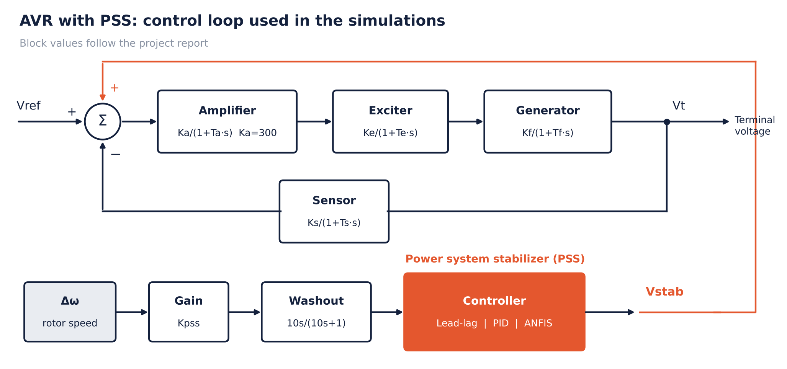
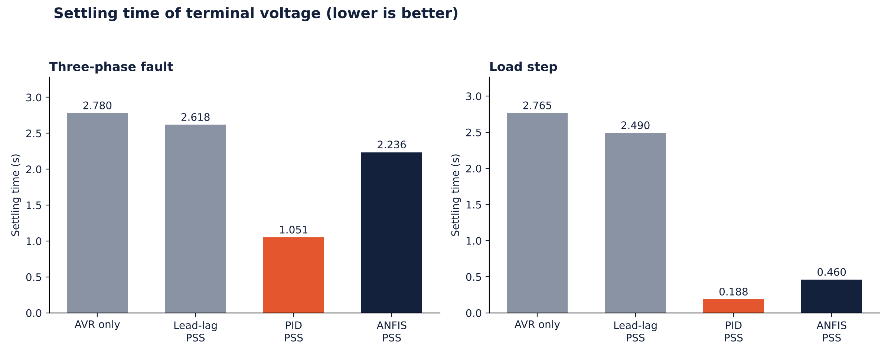
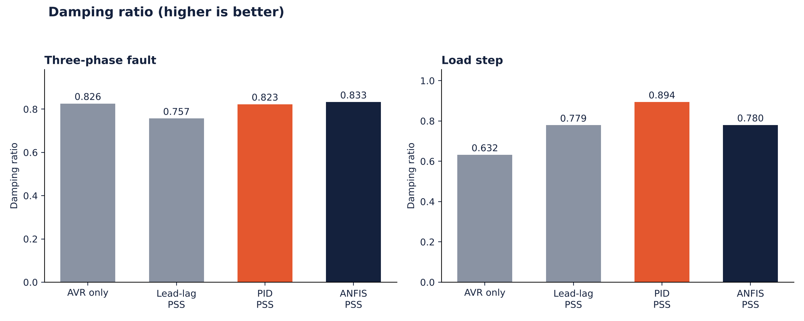
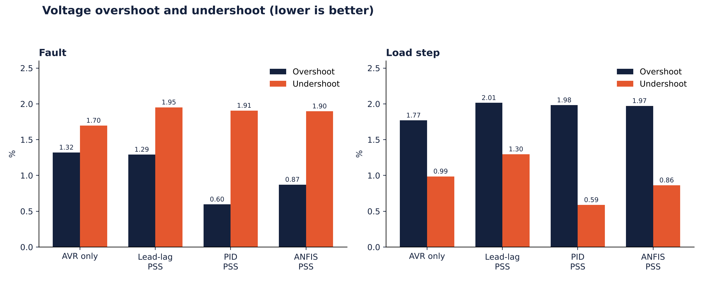

# Comparing PID, ANFIS and lead-lag stabilizers for generator voltage control

**Academic team project (5 members), final year BE Electrical Engineering, IOE Pashchimanchal Campus, Tribhuvan University, 2025.**

We used MATLAB/Simulink to test how three power system stabilizer (PSS) designs help a generator recover after a fault and a sudden load.

**My role:** I was the project head of the five-member team, and I did most of the simulation work and the calculation tables.

## The problem

An automatic voltage regulator (AVR) keeps a generator's terminal voltage steady, but its high gain can reduce damping and cause rotor oscillations after faults or load changes. A PSS adds that damping back. The common lead-lag PSS is hard to tune, so we asked whether a PID or ANFIS design could do better.

## What we built

- A Simulink model of a 200 MVA, 13.8 kV synchronous generator stepped up through a 210 MVA, 13.8/230 kV transformer to a 230 kV grid
- Four setups: AVR alone, AVR with a PSS2B-style lead-lag PSS, AVR with a PID-based PSS (auto-tuned in MATLAB), and AVR with an ANFIS-based PSS (trained on the PID controller's output over 50 epochs)
- Two tests: a three-phase fault on the high-voltage side (4.1 s to 4.2 s) and a load step at 9 s

## What we found

| Setup | Settling time, fault | Settling time, load step |
|---|---|---|
| AVR only | 2.78 s | 2.765 s |
| Lead-lag PSS | 2.618 s | 2.49 s |
| PID PSS | 1.051 s | 0.188 s |
| ANFIS PSS | 2.236 s | 0.4597 s |

The PID-based PSS settled fastest in both tests and had the lowest overshoot after the fault (0.596%). The ANFIS PSS came second. It was trained on PID data and not fully fine-tuned, so I see it as a promising base rather than a finished design.

Damping ratio results were mixed. After the fault, ANFIS (0.833) was slightly higher than PID (0.823), and the AVR-only case (0.826) was also slightly above PID. PID had the highest damping ratio only under the load step (0.894).

## Limits

Single machine connected to an infinite bus, simulation only, no hardware testing.

## Team

Bivek Kumar Mallik, Nutan Raj Pathak, Rajiv Pandit, Rohit Kumar Sah, Soniya Karki.
Supervisor: Asst. Prof. Suraj Shrestha.

<!-- The full report PDF is not linked. Its copyright page restricts publishing for financial gain without department approval. Ask the department before hosting it. -->
